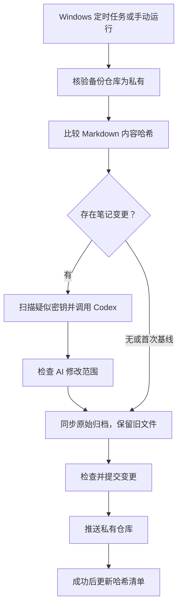

# Obsidian LLM Automation

用于 Windows 的 Obsidian 增量备份与 LLM Wiki 整理模板：源库只读，通过 SHA-256 识别变更的 Markdown，按需调用 Codex 整理专题，再同步原始归档并推送到独立的私有 GitHub 仓库。

此公共仓库只包含通用代码、空白模板与流程说明，没有个人笔记、履历、工作材料、本机配置或历史数据。运行时的源库和私有备份库由你自行配置。

## 工作流程



完整步骤见 [工作流程](docs/workflow.md)。

## 准备条件

- Windows PowerShell 5.1 或 PowerShell 7、Git。
- GitHub CLI（`gh`），已登录并具有读取目标私有仓库及推送的权限。
- 已安装并完成服务认证的 Codex CLI。脚本沿用模型 `gpt-6.1-sol` 和高推理强度；运行前确认你的服务配置支持它。
- 一个已有 Obsidian 源库和一个**独立的私有 GitHub 备份仓库**，后者本地分支为 `main`、工作区干净、`origin` 正确。

脚本会在读取笔记前通过 GitHub API 核验目标仓库为私有；核验失败或目标公开时停止。公共模板仓库本身不能用作同步目的地。

## 快速开始

1. 克隆本模板和你自己的私有备份仓库。以下路径均为示例。
2. 把本仓库的 `AGENTS.md`、`index.md`、`log.md` 复制到私有备份仓库，核对后先提交并推送，让工作区保持干净。已有这些文件时应合并规则，不覆盖已有知识。
3. 在模板仓库创建 `.local-state/`，将 `config.example.json` 复制为 `.local-state/config.json`，填入真实路径。
4. 验证路径、GitHub 登录和私有仓库推送权限，然后从模板仓库运行脚本。

```powershell
New-Item -ItemType Directory -Path '.local-state' -Force
Copy-Item -LiteralPath 'config.example.json' -Destination '.local-state/config.json'
# 编辑配置后，再运行：
powershell.exe -NoLogo -NoProfile -NonInteractive -ExecutionPolicy Bypass `
    -File '.\automation\nightly-windows.ps1'
```

首次没有哈希清单时，脚本只建立基线并同步原始归档，不会全量调用 AI。后续源 Markdown 新增、修改或删除才会触发增量整理。`-InitializeBaseline` 会重建基线，并非全量整理命令。

即使没有 Markdown 变化，仍会检查原始文件副本并尝试推送。非 Markdown 附件只参与归档，不单独触发 AI。脚本不会自动 pull/rebase 或解决 Git 冲突。

## 定时运行

在 Windows 任务计划程序中配置每日任务，执行时间由你选择，例如本机时间 21:00：

- 程序：`powershell.exe`
- 参数：`-NoLogo -NoProfile -NonInteractive -ExecutionPolicy Bypass -File "C:\Tools\Obsidian-LLM-Automation\automation\nightly-windows.ps1"`
- 起始目录：`C:\Tools\Obsidian-LLM-Automation`

替换示例路径，并使用能访问笔记目录、Git 和 Codex 认证的账户。状态目录默认在本模板的 `.local-state/`，也可通过 `OBSIDIAN_LLM_STATE_DIR` 覆盖。

## 文件说明

| 文件 | 用途 |
| --- | --- |
| [automation/nightly-windows.ps1](automation/nightly-windows.ps1) | 私有目标检查、增量整理、归档及推送 |
| [config.example.json](config.example.json) | 不含认证的本机路径配置示例 |
| [AGENTS.md](AGENTS.md) | 通用 Wiki 维护规则 |
| [index.md](index.md)、[log.md](log.md) | 私有备份仓库的空白入口模板 |
| [docs/workflow.md](docs/workflow.md) | 详细流程、边界与故障排查 |
| [tests/privacy-guard.ps1](tests/privacy-guard.ps1) | 使用模拟响应验证公开目标会被拒绝 |

## 数据边界

- 原始副本保留在私有仓库的 `原始笔记/`，同路径更新，源文件删除后旧副本保留。
- 排除设置、Git 元数据及匹配凭据规则的文件；文本扫描只是部分格式的检测，上传前仍需核对资料是否适合进入目标仓库。
- AI 整理会通过本机配置的服务处理读取的笔记；私有 GitHub 仓库与模型服务的数据边界需要分别考虑。
- 本公共模板忽略本机状态、原始归档和四个生成内容目录。私有备份仓库应使用自己的 Git 忽略规则，不能直接复制本模板的整份 `.gitignore`。
- 本次公开发布使用新建的单独 Git 历史，不包含原数据仓库的历史提交。

运行测试：

```powershell
powershell.exe -NoProfile -ExecutionPolicy Bypass -File '.\tests\privacy-guard.ps1'
```

该测试不连接真实 GitHub、不读取个人源库，也不调用模型。真实模型调用与定时任务需要在你的私有部署中另行核验。
