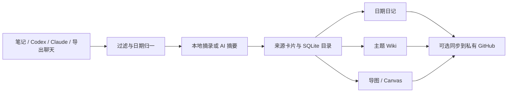

# Obsidian LLM · Personal Knowledge

把笔记和与 AI 的交流沉淀成可追溯的个人知识库，按**日期**回顾，按**主题**复用，用**导图**连接。

v0.2 使用一套 Python 核心运行于 Windows 和 macOS。公共仓库存放工具与虚构演示资料，真实知识保存在独立的本地工作区，可选择同步到私有 GitHub。

[查看演示知识库](examples/demo-wiki/Home.md) · [演示导图](examples/demo-wiki/Maps/Mindmap.md) · [演示时间线](examples/demo-wiki/Timeline.md) · [更新记录](CHANGELOG.md)

## 能做什么

| 入口 | 产物 |
| --- | --- |
| Obsidian / Markdown | 将指定笔记目录整理为带来源的知识卡片 |
| Codex / Claude Code | 读取明确配置的本机会话 JSONL，只提取用户与助手正文 |
| 手动导出的聊天 | 支持 Markdown、通用 JSON/JSONL 与 Claude 会话导出格式 |
| 日期 | `Daily/YYYY-MM-DD.md` 日记、`Timeline.md` 时间线；对话跨日按时区拆分 |
| 主题 | `Wiki/` 聚合来源摘要、明确决策、待解决问题 |
| 导图 | Mermaid 思维导图、关系图和可在 Obsidian 打开的 Canvas |
| 持续更新 | 内容哈希去重、增量摘要、本地搜索、Windows/macOS 调度配置 |



## 五分钟开始

需要 Python 3.10+。默认离线摘录模式不需要 API 密钥，也不会调用模型。下面的示例使用 macOS 路径；Windows 示例紧随其后。

```sh
git clone https://github.com/ltyfulan9/Obsidian-LLM-Automation.git
cd Obsidian-LLM-Automation
python3 -m venv .venv
source .venv/bin/activate
python -m pip install -e .
knowledge init --workspace ~/PersonalWiki
knowledge source markdown ~/Notes --workspace ~/PersonalWiki --name notes
knowledge sync --workspace ~/PersonalWiki
```

Windows 在仓库中运行：

```powershell
py -m venv .venv
.\.venv\Scripts\Activate.ps1
python -m pip install -e .
knowledge init --workspace 'C:\Notes\PersonalWiki'
knowledge source markdown 'C:\Notes\MyVault' --workspace 'C:\Notes\PersonalWiki' --name notes
knowledge sync --workspace 'C:\Notes\PersonalWiki'
```

然后用 Obsidian 打开 `PersonalWiki` 文件夹，从 `Home.md` 进入。工作区必须位于公共工具仓库之外，来源目录也不能包含工作区。

## 把 Codex 和 Claude 对话沉淀进来

按需添加来源，再同步：

```sh
knowledge source codex ~/.codex/sessions --workspace ~/PersonalWiki --name codex
knowledge source claude ~/.claude/projects --workspace ~/PersonalWiki --name claude
knowledge source export ~/ChatExports --workspace ~/PersonalWiki --name exports
knowledge sync --workspace ~/PersonalWiki
```

添加来源只登记路径，`sync` 才读取。支持 include/exclude 筛选；不会自动抓取账户中的全部云端聊天。Claude 网页/桌面导出与 Claude Code 本机会话是不同入口。目录及格式说明见[来源适配](docs/sources.md)。

### 使用 AI 归纳

默认 `extract` 是有限关键词分类与原文摘录，页面会明确标注。需要语义摘要时，安装并完成相应 CLI 认证，再选择引擎：

```sh
knowledge sync --workspace ~/PersonalWiki --engine codex
# 或
knowledge sync --workspace ~/PersonalWiki --engine claude
```

长期默认项在工作区 `.knowledge/config.json` 的 `engine.name` 修改。模型名默认不指定，沿用本机 CLI 配置；`engine.model` 和 `engine.command` 可覆盖。外部模型失败会报错，不会悄悄换成摘录并标为 AI 成果。长对话分段整理后再分层合并。

## 知识库结构

```text
PersonalWiki/
  Home.md                 首页：主题与最近日期
  Timeline.md             按月组织的日期索引
  Daily/                  每日学习与交流记录
  Wiki/                   跨日期主题知识
  Sources/                带证据与出处的摘要卡片
  Maps/                   Mindmap.md / Graph.md / Knowledge.canvas
  Notes/                  你的手写知识，生成器保持不动
  Archive/                可选的规范化来源正文，默认不开启
  .knowledge/             本地配置、SQLite、锁与生成记录，Git 忽略
```

生成页有修改保护。手写长期内容放在 `Notes/`；直接修改生成页后，下次构建会停止并提示，避免覆盖你的编辑。来源删除后保留已有知识，并标记来源不再可用。

## 搜索、重建与同步

```sh
knowledge search --workspace ~/PersonalWiki 'Python'
knowledge build --workspace ~/PersonalWiki
knowledge status --workspace ~/PersonalWiki
```

`build` 从已有摘要重建视图，不重复调用模型。`sync` 采集新变化。原始正文默认只在被忽略的本地目录数据库中保存；`include_raw: true` 才额外生成 `Archive/`。本工具不替代附件与原文件的完整备份。

需要 GitHub 同步时，将工作区建立为你自己的**私有仓库**、分支设为 `main`、配置 `origin`，并通过 GitHub CLI 登录：

```sh
knowledge sync --workspace ~/PersonalWiki --push
# 推送失败后，可以只重试发布：
knowledge publish --workspace ~/PersonalWiki
```

工具在 `--push` 读取资料前核验目标私有，并在发送前再次检查。只暂存生成文件及 `Notes/`；不会强推、自动 rebase 或混入既有暂存内容。真实资料不应提交到本公共仓库。

## Windows 与 macOS 自动化

同一个 `sync` 命令由不同系统的原生调度器运行：

- macOS：`knowledge schedule --platform macos ...` 生成 launchd plist。
- Windows：`knowledge schedule --platform windows ...` 生成任务计划 XML。

生成器不会隐式安装后台任务。[完整调度与安装步骤](docs/scheduling.md)。归档时区与系统触发时间分别配置，跨机器建议使用相同的归档时区。

## 验证与实现边界

```sh
python -m unittest discover -s tests -p 'test_*.py' -v
python -m examples.build_demo
```

GitHub Actions 在 Linux、Windows、macOS 和 Python 3.10/3.12 上运行同一套测试，覆盖原生对话过滤、跨日归档、增量去重、错误回滚、手写内容保留、公开目标拒绝和调度配置。CI 状态见 [Actions](https://github.com/ltyfulan9/Obsidian-LLM-Automation/actions)。

原生会话文件是客户端内部格式，适配器提供兼容性读取，不承诺覆盖所有历史/未来版本。隐藏推理、工具结果、图片及 PDF 不作为正文导入。摘要仍需对照来源判断准确性。

[架构与失败语义](docs/architecture.md) · [流水线与排错](docs/workflow.md) · [来源与官方接口依据](docs/sources.md)

本机测试和真实 CLI 调用记录见[验证记录](docs/validation.md)。

旧版 `automation/nightly-windows.ps1` 作为原文件归档流程保留，详见[旧版说明](docs/legacy-windows.md)；它与 v0.2 工作区和配置不同，不应同时管理同一目录。
