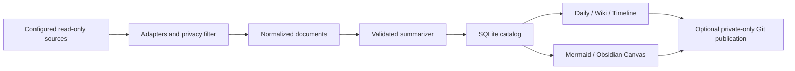

# Architecture

## Domain and boundaries

The public **tool repository** contains code and invented fixtures. A separate **knowledge workspace** contains the user's material and can be a private GitHub repository. An Obsidian vault or CLI session directory is a read-only **source**.

A **document** is one Markdown file or one conversation/day pair. Its stable ID derives from the source alias, relative filename, exported conversation identity and local calendar date. Moving a file or changing its source alias creates a new document; old records remain as history.

A **source card** is a dated summary with source references, topics, key points, explicit decisions and unresolved questions. Daily pages, topic pages and maps are projections of the same catalog, so the two navigation dimensions agree.

## Modules

| Module | Owns | Does not own |
| --- | --- | --- |
| `ingest.py` | File filtering, native adapters, timezone date split, source identity | Model calls, output files |
| `summarize.py` | Extraction, CLI invocation, chunking, strict result validation | Workspace paths and Git |
| `catalog.py` | Transactional content/engine hashes, summaries, availability | Rendering |
| `render.py` | Markdown, deterministic topic paths, maps, edit detection | Source reads and provider configuration |
| `publish.py` | Exact generated-file staging, secret checks, private GitHub guard | Collection or model selection |
| `service.py` | Pipeline order, locking, config validation, run result | Native OS registration |
| `schedule.py` | launchd plist / Task Scheduler XML | Installing or enabling jobs |

## Failure semantics

Collection reads explicit roots and applies include/exclude globs. Sources cannot contain the output workspace. Individual missing records are retained and marked unavailable. A missing source root fails the run instead of declaring its entire contents deleted.

Content and engine configuration hashes decide whether a summary needs updating. Model failures roll back the current catalog transaction. Rendering follows a successful transaction and can be retried with `knowledge build` without repeating model calls.

Every generated file is registered with a content hash. Before generation, edits to existing generated pages stop the build. Move intended handwritten edits to `Notes/`, restore the generated page, then retry. Do not remove the registry as a workaround. Individual writes are atomic; a power loss between multiple output writes may require manual reconciliation with the registry. This is not a filesystem-wide transaction.

Local collection and Git publication are separate. A publication failure does not roll back successfully collected knowledge. `knowledge publish` retries Git without reprocessing sources. Conflicts need human resolution; the tool never force pushes or silently rebases.

With `--push`, the target is verified private before collection and again immediately before transmission. Provider stderr and raw result bodies are not printed, since they can echo private prompts.

## Meaning and limits

Extraction is labeled as an excerpt. AI summaries are labeled for verification and retain source aliases/relative paths. Topic pages aggregate dated evidence and deduplicate decisions/questions; they do not adjudicate contradictory claims or create a verified biography.

Normalized text is held in ignored local SQLite state. `include_raw` defaults to `false`; enabling it adds normalized text to `Archive/` for optional private publication. This is a text knowledge importer, not a byte-for-byte backup of images, PDFs, plugin state or session metadata. The legacy archive script serves that older use case.

Turning raw archives off removes those generated files from later snapshots and publication, but does not purge earlier private Git history.
