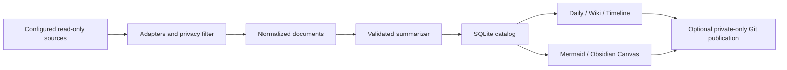

# Architecture

## Domain and boundaries

The public **tool repository** contains code and invented fixtures. A separate **knowledge workspace** contains the user's material and can be a private GitHub repository. An Obsidian vault or CLI session directory is a read-only **source**.

A **document** is one Markdown file or one conversation/day pair. Its stable ID derives from the source alias, relative filename, exported conversation identity and local calendar date. Moving a file or changing its source alias creates a new document; old records remain as history.

A **source card** is a dated summary with source references, topics, key points, explicit decisions and unresolved questions. Daily pages, topic pages and maps are projections of the same catalog, so the two navigation dimensions agree.

A **check-in** is a dated self-report of completed work, blockers and lessons. A **commitment** is explicitly confirmed by the user, with an optional deadline, expected result and source-card reference. Its append-only status events record deferrals, actual outcomes, cancellation and reopening. Imported plans and AI questions never create commitments automatically. A **review** applies transparent local rules to those observations and events, retaining evidence and uncertainty rather than rating a person.

## Modules

| Module | Owns | Does not own |
| --- | --- | --- |
| `ingest.py` | File filtering, native adapters, timezone date split, source identity | Model calls, output files |
| `summarize.py` | Extraction, CLI invocation, chunking, strict result validation | Workspace paths and Git |
| `catalog.py` | Transactional content/engine hashes, summaries, availability | Rendering |
| `reflection.py` | User-confirmed check-ins, commitment transitions, historical state and review rules | Model calls or personality judgments |
| `personal_render.py` | Daily self-reports, task history and evidence-linked weekly projections | Source ingestion or task inference |
| `render.py` | Markdown, deterministic topic paths, maps, edit detection | Source reads and provider configuration |
| `publish.py` | Exact generated-file staging, secret checks, private GitHub guard | Collection or model selection |
| `service.py` | Pipeline order, locking, config validation, run result | Native OS registration |
| `schedule.py` | launchd plist / Task Scheduler XML | Installing or enabling jobs |

## Failure semantics

Collection reads explicit roots and applies include/exclude globs. Sources cannot contain the output workspace. Individual missing records are retained and marked unavailable. A missing source root fails the run instead of declaring its entire contents deleted.

Content and engine configuration hashes decide whether a summary needs updating. Model failures roll back the current catalog transaction. Rendering follows a successful transaction and can be retried with `knowledge build` without repeating model calls.

Every generated file is registered with a content hash. Before generation, edits to existing generated pages stop the build. Move intended handwritten edits to `Notes/`, restore the generated page, then retry. A durable render journal records old hashes and intended content before pages change. The next build resumes an interrupted generation, accepting only old or intended hashes; edits made after interruption stop recovery. This is recoverable multi-file generation, not a filesystem-wide transaction.

The workspace uses an OS advisory lock: a process exit releases it even if the lock file remains. Successful model chunks are cached under ignored local state, so a later model or catalog failure does not discard paid successful calls. Timeouts clean up the spawned process group and retry a bounded number of times.

Local collection and Git publication are separate. A publication failure does not roll back successfully collected knowledge. `knowledge publish` retries Git without reprocessing sources. Conflicts need human resolution; the tool never force pushes or silently rebases.

Personal tables are added in place when opening an older catalog. Check-ins merge with exact deduplication, unless explicitly replaced; commitment events preserve date order per task. Saved personal facts remain committed if rendering fails; the error distinguishes this state and `knowledge build` regenerates pages without another provider call. Weekly projections replay only events up to the week-end cutoff, while the current week stops at today. They can change after intentional historical corrections; they are not immutable audit snapshots.

With `--push`, the target is verified private before collection and again immediately before transmission. Provider stderr and raw result bodies are not printed, since they can echo private prompts.

## Meaning and limits

Extraction is labeled as an excerpt. AI summaries are labeled for verification and retain source aliases/relative paths. Topic pages aggregate dated evidence and deduplicate decisions/questions; they do not adjudicate contradictory claims or create a verified biography.

Normalized text is held in ignored local SQLite state. `include_raw` defaults to `false`; enabling it adds normalized text to `Archive/` for optional private publication. This is a text knowledge importer, not a byte-for-byte backup of images, PDFs, plugin state or session metadata. The legacy archive script serves that older use case.

Turning raw archives off removes those generated files from later snapshots and publication, but does not purge earlier private Git history.

Review rules flag overdue open commitments, at least two deferrals of the same task in 28 days, and identical blocker wording on at least three distinct dates in 28 days. They ask the user to check explanations; missing observations are unknown, and causal, personality or medical conclusions are outside the model. The generated Markdown is a readable export; operational personal state remains in ignored SQLite and needs a separate secure local backup for migration.
